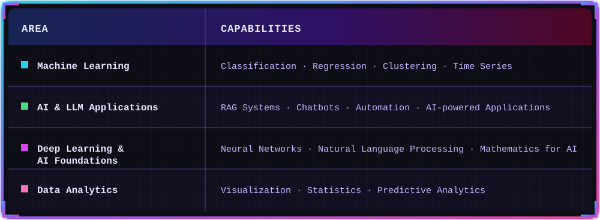
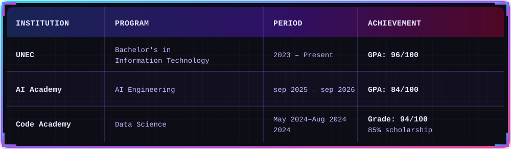

  

---

## ⭐ About Me

I am a fourth-year **Information Technology** student focused on **AI/ML Engineering**. I have hands-on experience developing AI-driven solutions, including automation workflows and AI-powered applications, as well as developing and optimizing machine learning models. My areas of interest include machine learning, data analysis, LLM applications, deep learning and natural language processing.

 

---

## What I Work With

  

---

## 💼 Experience

### AI Engineer Intern · Kontakt Home
`July 2026 – August 2026`

> Worked on AI-driven automation, RAG-based systems and AI-powered sales and conversational applications. Contributed to the development, integration and optimization of LLM workflows for practical business use cases.

---

## 🎓 Education

  

